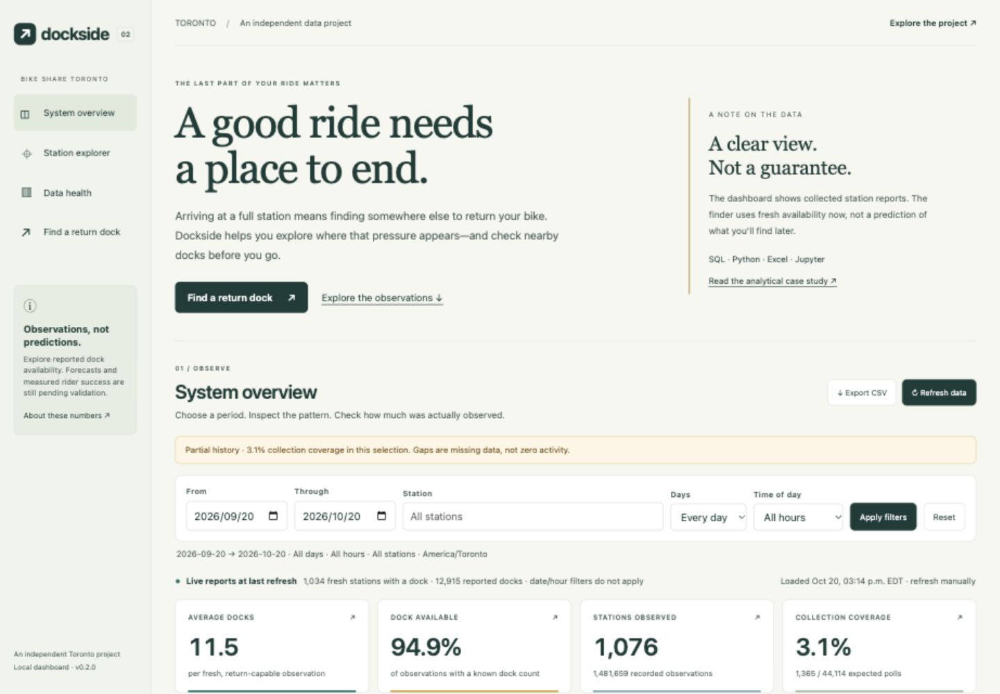
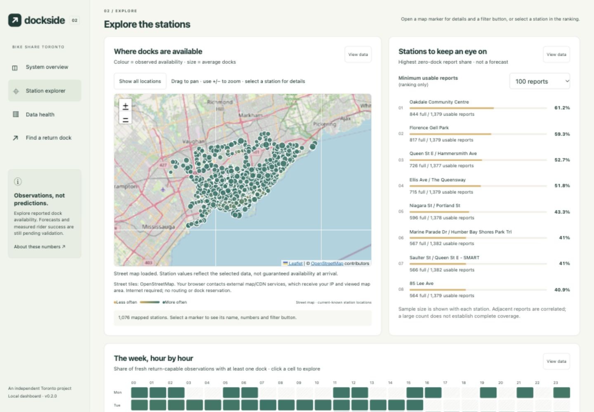

# Dockside — Toronto Bike Share Analytics

**A data analyst portfolio project: where do collected station reports show return-dock pressure, and how much can we trust the evidence?**

SQL (PostgreSQL) · Python / pandas · Excel · Jupyter · Data visualization

Real public GBFS observations, a reproducible analytical case study, and an
interactive dashboard. The analysis examines station-level dock availability,
nearby alternatives and collection quality—not individual trips or rider behavior.

**Main takeaway:** the data identifies stations worth monitoring, but incomplete
collection prevents month-long reliability claims. Prioritizing better coverage
is a more defensible next step than claiming predictive performance.

## Start here — no installation required

| Review | What you can inspect |
| --- | --- |
| [Executed Jupyter notebook](analysis/portfolio/Dockside_Case_Study.ipynb) | Questions, Python calculations, charts, findings and limitations |
| [SQL queries](analysis/portfolio/sql/) | Deduplication, joins, conditional aggregation, coverage and nearby-station analysis |
| [Excel workbook](outputs/portfolio-2026-10-17/Dockside_Analysis.xlsx) | Seven worksheets, formula-linked views, native charts, filterable tables and two dropdown controls; download to open |
| [Six-page notebook PDF](output/pdf/Dockside_Case_Study.pdf) | A concise, readable export of the executed analysis |
| [Findings and verification record](analysis/portfolio/findings.md) | Exact denominators, quality checks, delivery evidence and unresolved issues |

The notebook includes saved outputs. Published aggregate files allow this edition
to be reproduced without access to the private local database. The workbook is a
frozen analysis, not a live connection; it does not claim Power Query or PivotTables.

## Analytical questions

1. **Where was return-dock pressure observed?** Compare zero-dock report shares
   across stations with sufficient observed support.
2. **Was a nearby option available when a station was full?** Inspect the nearest
   eligible neighbor in the same fetched feed, without selecting it for having a dock.
3. **What patterns appear by local hour and weekday/weekend?** Show support counts
   and leave insufficiently supported chart cells blank.
4. **Is the evidence complete and robust enough to support a decision?** Audit
   missing collection periods, duplicate/conflicting reports and freshness rules.

The intended decision is **where to focus follow-up monitoring**, not a proven
fleet-rebalancing intervention or a guarantee that a rider will find a dock.

## Findings — with denominators and limits

**Frozen study window:** September 16, 2026, 18:55 UTC to October 17, 2026,
17:00 UTC (exclusive). It spans 32 Toronto calendar dates with partial boundary
days; only 11 dates contain eligible reports. This is not a continuously observed month.

| Finding | Measured evidence | Supported interpretation |
| --- | --- | --- |
| Most eligible reports showed a dock | 790,386 / 840,283 = **94.1%** | Availability among observed eligible reports, not elapsed-time reliability or prediction accuracy |
| Collection continuity was the main limitation | 1,503 / 44,525 expected minute slots = **3.4%** successful polling coverage; 21 dates had no attempted polls | Millions of station rows do not substitute for complete temporal coverage |
| Some stations had much higher observed full shares | Queen St E / Hammersmith Ave: **443 / 782 = 56.6%**; Ellis Ave / The Queensway: **416 / 781 = 53.3%** | Candidates for further monitoring, not a ranking of Toronto's worst stations |
| Nearby availability varied by location | For full reports at station 7315, the nearest eligible neighbor had a dock in **219 / 442 matched reports = 49.5%**, at a mean 255 m; one of 443 full reports was unmatched | A same-feed, straight-line comparison—not a later-arrival or backup-success rate |
| Freshness sensitivity did not change the rounded headline | 60-, 120- and 300-second thresholds each yielded **94.1%** to one decimal place; excluding conflicting source timestamps yielded **94.0%** | Limited sensitivity to these rules does not repair missing-time selection bias |

Station rankings require at least **100 eligible reports across five dates**.
Hourly chart cells require at least **100 reports across three dates**. Eligibility
means fresh, installed, accepting returns and a known reported dock count.

**Recommended next steps:** improve collection continuity and maintenance;
investigate future-time quarantines and same-timestamp conflicts; then repeat
comparisons on matched stations and well-covered dates across independent weeks.
No operational change, cost saving or rider-success improvement has been measured.

## SQL and analytical skills — inspect the evidence

| Skill | Implementation and purpose |
| --- | --- |
| CTEs and window functions | [00_prepare.sql](analysis/portfolio/sql/00_prepare.sql): `ROW_NUMBER()` retains the first canonical retrieval per station/source report timestamp, rather than counting repeated retrievals as independent evidence |
| Time-aware joins and eligibility | [00_prepare.sql](analysis/portfolio/sql/00_prepare.sql): join the recorded metadata version, enforce the extraction cutoff, preserve nulls and use reported usable docks |
| Honest completeness denominators | [00_prepare.sql](analysis/portfolio/sql/00_prepare.sql) and [02_daily.sql](analysis/portfolio/sql/02_daily.sql): `generate_series` plus a `LEFT JOIN` includes unattempted minutes |
| Conditional aggregation | [03_stations.sql](analysis/portfolio/sql/03_stations.sql) and [04_time_patterns.sql](analysis/portfolio/sql/04_time_patterns.sql): `FILTER`, grouped counts and Toronto-local calendar fields expose each rate's denominator |
| Spatial comparison | [07_nearby.sql](analysis/portfolio/sql/07_nearby.sql): same-feed self-join, Haversine distance and deterministic nearest-neighbor selection within 750 m; selection does not depend on having a dock |
| Data-quality and sensitivity analysis | [01_quality.sql](analysis/portfolio/sql/01_quality.sql), [06_sensitivity.sql](analysis/portfolio/sql/06_sensitivity.sql), [09_conflict_sensitivity.sql](analysis/portfolio/sql/09_conflict_sensitivity.sql) and [10_quarantine_reasons.sql](analysis/portfolio/sql/10_quarantine_reasons.sql) make exclusions and rule sensitivity reviewable |
| Reproducible extraction | [export.py](analysis/portfolio/export.py): `REPEATABLE READ READ ONLY`, a frozen configuration, aggregate exports and SHA-256 manifests; no source-table updates or deletes |
| Python and communication | [Notebook](analysis/portfolio/Dockside_Case_Study.ipynb): pandas tables, matplotlib figures and interpretations alongside code; [Excel](outputs/portfolio-2026-10-17/Dockside_Analysis.xlsx) exposes formula-linked comparisons for nontechnical readers |

## Data and methodology

The source is Bike Share Toronto's **public GBFS station-information and
station-status feeds**, not its internal transaction database. A Python collector
builds local PostgreSQL history from these live responses.

```text
Public GBFS → Python collector → PostgreSQL snapshots + versioned metadata
                                      ├─ FastAPI → interactive dashboard
                                      └─ read-only SQL → frozen CSV / JSON
                                                           ├─ Jupyter → HTML / PDF
                                                           └─ Excel workbook
```

- The extract contains **1,628,401 live snapshot rows**, reduced to 840,383 unique
  canonical station/report timestamps and **840,283 eligible reports** across
  1,075 observed stations. Fixtures and synthetic demonstrations are excluded.
- Source-report, retrieval and ingestion times remain distinct. Storage uses UTC;
  calendar analysis uses `America/Toronto`.
- Reported functional docks are authoritative. Unknown counts stay unknown;
  capacity minus bikes is not substituted for available docks.
- Missing periods are not interpolated. Nearby comparisons use metadata recorded
  with the observation and disclose unmatched cases.
- Public exports contain station aggregates and provenance fingerprints, not
  credentials, rider destinations or a database dump. Raw evidence stays local.

See the [analysis contract and reproduction instructions](analysis/portfolio/README.md),
[data dictionary](docs/data-dictionary.md) and
[extraction manifest](analysis/portfolio/data/manifest.json).

## Limitations and current scope

- **Report-weighted, not time-weighted:** irregular collection and source update
  frequency affect representation. Adjacent observations are correlated.
- **Incomplete and selective history:** gaps prevent seasonal or month-long
  generalization. Hourly differences may reflect changing dates and station mix;
  no causal peak-period effect is established.
- **Unresolved quality issues:** 31,070 station/report timestamps have conflicting
  statuses; 198,740 quarantined records carry `future_last_reported`. The timestamp
  cause is not established. Diagnostics can overlap and are not an additive waterfall.
- **No trip inference:** inventory changes cannot identify individual pickups,
  returns, lost trips or rebalancing actions.
- **No validated forecast:** current recommendations use fresh availability and
  distance. No measured recommendation uplift or rider trial is available.
- **Separate deliverable statuses:** the browser dashboard is working software;
  a Windows-authored, refreshed and verified Power BI report remains pending.

## Interactive dashboard



*Real collected observations, captured October 20, 2026—not the frozen October 17
case-study view. Dashboard polling-observation aggregates and notebook
source-timestamp-deduplicated reports use different denominators and can differ.*

Filter dates, stations, weekday/weekend and local hour; inspect chart data, explore
real street maps and export CSVs. A ranking-only minimum-report control and visible
numerators/denominators help reveal sparse support. “Show all stations” clears a
station focus without resetting time filters. The separate dock finder uses fresh current
availability and distance, not a validated arrival forecast. No animation or
external map account is required. This is a **local application**, not a hosted demo.

The **Deeper analysis** section adds four complementary views: station full-share
distribution, average docks versus full-share scatter, weekday/weekend hourly
comparison, and an observation-quality breakdown. Each has an explained denominator,
main-filter context, an inspectable table and CSV export. Support thresholds and
missing outcomes remain visible. These demonstrate descriptive analysis—not causal
effects, trip demand or validated prediction. See the [chart formulas and interview
walkthrough](docs/dashboard.md#deeper-analysis--what-the-average-hides).
Preview the [distribution and scatter](docs/images/deeper-analysis-2026-10-20.png)
and [group comparison and quality breakdown](docs/images/analysis-quality-2026-10-20.png).
These screenshots use the live dashboard's selected September 20–October 20 window,
not the frozen notebook window.



Latest local verification: **69 Python tests**, including disposable
PostgreSQL integration checks, and **14 frontend tests** passed. See the
[maintenance findings and limitations](docs/usability-review.md#portfolio-maintenance--2026-10-20)
and [dashboard guide](docs/dashboard.md). Run `make test-ui` for the Node frontend
checks; software tests do not establish forecast accuracy or rider success.

## Run the live application

<details>
<summary>Expand setup, launch commands and operating requirements</summary>

```sh
git clone https://github.com/ianlin1222/toronto-bike-share-dashboard.git
cd toronto-bike-share-dashboard
```

On this Mac, double-click **Start.command**, or open the project terminal and run:

```sh
make start
```

Open **http://127.0.0.1:8080/dashboard** (also the home page).

1. Choose dates, a station, weekdays/weekends or a local hour; click **Apply filters**.
2. Click a chart point or **View data** to inspect numbers. Click an hourly bar,
   ranking to filter; on the street map, open a marker and use its filter button.
   Click a KPI to see its calculation.
3. Use **Export CSV** for the filtered station table, or download an individual
   chart's data from its inspector. Click **Refresh data** for new observations.
4. Select **Find a return dock** for the existing recommendation tool at `/demo`.

The default range shows available history within the last 31 days ending at the
latest stored hour. Missing history is visibly blank, never replaced with samples.
For existing installations, run `make dashboard-backfill` once after `make start`
to summarize retained observations for the new charts. This does not fetch or
invent past observations. New collection updates the summaries automatically.

The dock finder accepts City Hall, Union Station, U of T, station suggestions or
exact coordinates. It is not a general address geocoder. See
[the dashboard guide](docs/dashboard.md) for the charts and metric definitions.

The launcher detects the Docker Desktop Compose installation, creates secure local
credentials in the ignored `.env` file, runs migrations, starts collection, and
waits for a fresh live batch. It preserves existing credentials. The first build
downloads dependencies and can take several minutes. Docker Desktop must be
installed; complete its first-run prompts if requested. Python 3.11+ is used by the
launcher, and Python 3.13 runs inside the containers.

The launcher checks for at least **10 GB of free disk space** before building
(20 GB is recommended for build overhead and ongoing collection). If Docker
reports a read-only filesystem after a disk-full error, free space and restart
Docker Desktop before retrying. **Do not factory-reset Docker or delete the
PostgreSQL volume**: that would remove collected history.

The API binds to localhost port **8080**, PostgreSQL to **55432**. If either is
occupied, the launcher tells you which `.env` setting to change. Internal database
URLs continue to use `db:5432`; do not change them when changing the host port.

```sh
make status       # Show running services
make logs         # Recent collector/API diagnostics
make doctor       # Check Docker, Compose and application health
make stop         # Stop this project; preserve collected data
make start        # Start it again
```

Keep Docker Desktop running for collection. Closing the terminal after startup is
fine. Laptop sleep, shutdown, or a network outage interrupts collection. The app
shows unavailable/stale states instead of inventing fresh data.

## Try it without Docker

With uv installed, run `make demo` and open the localhost URL printed in the
terminal (normally **http://127.0.0.1:8081/dashboard**). Its charts are explicitly
labeled **synthetic demonstration data**, not measured performance. This selects
sample mode even if `.env` is configured for live collection. Press **Ctrl+C** to stop.

</details>

## Engineering and validation status (2026-10-17)

The [verification record](analysis/portfolio/findings.md#verification-and-reproducibility)
documents 65 passing tests in the earlier disposable-PostgreSQL run and 57 passing
non-database tests after the notebook revision (overlapping suites, not additive).
All ten notebook cells executed without errors and all six PDF pages were visually
reviewed. Workbook formula/container checks passed; native Microsoft Excel UI
verification remains pending. These are recorded checks, not uptime guarantees.

- The live feed → PostgreSQL 18.6 → API → browser recommendation path has been
  exercised on this Mac. It recommends by fresh **current availability and distance**.
- The v0.2 dashboard serves real historical aggregates and separate current reports.
  Collection has substantial gaps; dates spanning those gaps are not continuous
  coverage. The browser updates only when you apply filters or refresh it.
- Forecast probabilities and measured recommendation uplift remain unavailable.
  Feature/label/model-selection components exist, but live extraction/training,
  evaluation orchestration, and approved-model serving still require implementation
  and verification as well as qualifying history. `train --dataset live` remains
  blocked; collecting 84 days alone does not automatically enable it.
- Power BI SQL and authoring assets exist. A real report still requires Windows
  authoring and refresh verification. The browser dashboard is not a PBIX substitute.
- “82% success” and “+14 percentage points” are unverified and must not be claimed.

## Architecture

```text
Toronto GBFS → ingestion worker → PostgreSQL → FastAPI → dashboard + dock finder
                    │                 │
             raw hashes/history      ├─ reporting views → Power BI authoring assets
                                     └─ feature/label/model components (validation pending)
```

Collection runs separately from web requests. Source, retrieval and ingestion
timestamps remain distinct; retries are idempotent and station metadata is
versioned. Missing observations stay missing. Point-in-time tests protect the
future modeling workflow against leakage.

This is a local-first portfolio project, not an official Bike Share Toronto app.
There is no public hosted application or validated prediction model yet.

## Development and checks

```sh
make bootstrap    # Locked developer environment; requires uv
make lint
make test-unit
make test-contract
make test         # Full suite in an isolated PostgreSQL test service
make smoke        # Live HTTP check on port 8080
make data-audit
```

Tests use a separate temporary database and sample data. `make test` never resets
the live collection database. The API documentation is at **/docs**; status is at
**/readyz**. See [docs/usability-review.md](docs/usability-review.md) for the usability
audit, fixes, verification, and remaining work.

Use only exact horizons `5`, `10`, `15`, and `30` minutes. The default radius is
750 m and supported bounds are 100–2,000 m. Distances are Haversine/geographical,
not walking or cycling routes. Forecasts do not reserve docks.

See [PLANS.md](PLANS.md) for milestone and evidence status, and
[docs/sources.md](docs/sources.md) for source provenance.

## Explore the engineering

- [Five-minute demonstration](docs/demo-walkthrough.md)
- [Dashboard guide and metric definitions](docs/dashboard.md)
- [Data dictionary](docs/data-dictionary.md) and [feature contract](docs/feature-contract.md)
- [Evaluation protocol](docs/evaluation-protocol.md) and [model status](docs/model-card.md)
- [Operations](docs/operations.md), [verification evidence](docs/verification.md) and [Power BI build guide](powerbi/BUILD.md)

## License and attribution

Software is licensed under [MIT](LICENSE). Contains information licensed under the
Open Government Licence – Toronto; data is provided by City of Toronto / Bike Share
Toronto. The software license does not relicense source data. See the
[source index](docs/sources.md) for provenance and the recorded licensing discrepancy.
