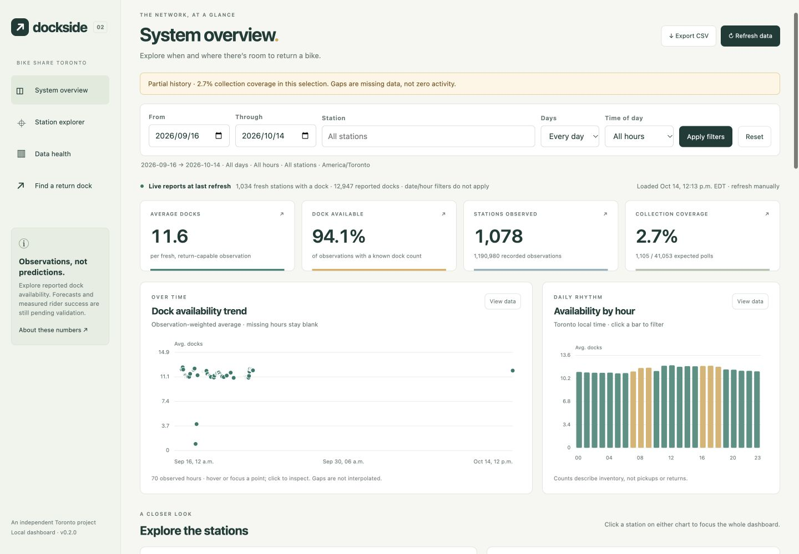

# Dockside — Toronto Bike Share Dashboard

**Explore dock availability, investigate collection gaps, and find a nearby return station.**

Python · PostgreSQL · FastAPI · Docker Compose · vanilla JavaScript



*Real collected observations, captured October 14, 2026. Historical gaps are visible.
Observed availability is not forecast accuracy or rider recommendation success.*

A Bike Share Toronto availability dashboard and return-station finder. Version
0.2 adds manually interactive charts, station exploration and CSV exports over
the project's real collected dock reports. No animation or external map account
is required. The finder ranks current availability; validated forecasts remain pending.

## Run the live application

```sh
git clone https://github.com/ianlin1222/toronto-bike-share-dashboard.git
cd toronto-bike-share-dashboard
```

On this Mac, double-click **Start.command**, or open the project terminal and run:

```sh
make start
```

Open **http://127.0.0.1:8080/dashboard** (also the home page).

1. Choose dates, a station, weekdays/weekends or a local hour; click **Apply filters**.
2. Click a chart point or **View data** to inspect numbers. Click an hourly bar,
   station bubble or ranking to filter. Click a KPI to see its calculation.
3. Use **Export CSV** for the filtered station table, or download an individual
   chart's data from its inspector. Click **Refresh data** for new observations.
4. Select **Find a return dock** for the existing recommendation tool at `/demo`.

The default range shows available history within the last 31 days ending at the
latest stored hour. Missing history is visibly blank, never replaced with samples.
For existing installations, run `make dashboard-backfill` once after `make start`
to summarize retained observations for the new charts. This does not fetch or
invent past observations. New collection updates the summaries automatically.

The dock finder accepts City Hall, Union Station, U of T, station suggestions or
exact coordinates. It is not a general address geocoder. See
[the dashboard guide](docs/dashboard.md) for the charts and metric definitions.

The launcher detects the Docker Desktop Compose installation, creates secure local
credentials in the ignored `.env` file, runs migrations, starts collection, and
waits for a fresh live batch. It preserves existing credentials. The first build
downloads dependencies and can take several minutes. Docker Desktop must be
installed; complete its first-run prompts if requested. Python 3.11+ is used by the
launcher, and Python 3.13 runs inside the containers.

The launcher checks for at least **10 GB of free disk space** before building
(20 GB is recommended for build overhead and ongoing collection). If Docker
reports a read-only filesystem after a disk-full error, free space and restart
Docker Desktop before retrying. **Do not factory-reset Docker or delete the
PostgreSQL volume**: that would remove collected history.

The API binds to localhost port **8080**, PostgreSQL to **55432**. If either is
occupied, the launcher tells you which `.env` setting to change. Internal database
URLs continue to use `db:5432`; do not change them when changing the host port.

```sh
make status       # Show running services
make logs         # Recent collector/API diagnostics
make doctor       # Check Docker, Compose and application health
make stop         # Stop this project; preserve collected data
make start        # Start it again
```

Keep Docker Desktop running for collection. Closing the terminal after startup is
fine. Laptop sleep, shutdown, or a network outage interrupts collection. The app
shows unavailable/stale states instead of inventing fresh data.

## Try it without Docker

With uv installed, run `make demo` and open the localhost URL printed in the
terminal (normally **http://127.0.0.1:8081/dashboard**). Its charts are explicitly
labeled **synthetic demonstration data**, not measured performance. This selects
sample mode even if `.env` is configured for live collection. Press **Ctrl+C** to stop.

## Status and limitations (2026-10-14)

- The live feed → PostgreSQL 18.6 → API → browser recommendation path has been
  exercised on this Mac. It recommends by fresh **current availability and distance**.
- The v0.2 dashboard serves real historical aggregates and separate current reports.
  Collection has substantial gaps; dates spanning those gaps are not continuous
  coverage. The browser updates only when you apply filters or refresh it.
- Forecast probabilities and measured recommendation uplift remain unavailable.
  Feature/label/model-selection components exist, but live extraction/training,
  evaluation orchestration, and approved-model serving still require implementation
  and verification as well as qualifying history. `train --dataset live` remains
  blocked; collecting 84 days alone does not automatically enable it.
- Power BI SQL and authoring assets exist. A real report still requires Windows
  authoring and refresh verification. The browser dashboard is not a PBIX substitute.
- “82% success” and “+14 percentage points” are unverified and must not be claimed.

## Architecture

```text
Toronto GBFS → ingestion worker → PostgreSQL → FastAPI → dashboard + dock finder
                    │                 │
             raw hashes/history      ├─ reporting views → Power BI authoring assets
                                     └─ feature/label/model components (validation pending)
```

Collection runs separately from web requests. Source, retrieval and ingestion
timestamps remain distinct; retries are idempotent and station metadata is
versioned. Missing observations stay missing. Point-in-time tests protect the
future modeling workflow against leakage.

This is a local-first portfolio project, not an official Bike Share Toronto app.
There is no public hosted application or validated prediction model yet.

## Development and checks

```sh
make bootstrap    # Locked developer environment; requires uv
make lint
make test-unit
make test-contract
make test         # Full suite in an isolated PostgreSQL test service
make smoke        # Live HTTP check on port 8080
make data-audit
```

Tests use a separate temporary database and sample data. `make test` never resets
the live collection database. The API documentation is at **/docs**; status is at
**/readyz**. See [docs/usability-review.md](docs/usability-review.md) for the usability
audit, fixes, verification, and remaining work.

Use only exact horizons `5`, `10`, `15`, and `30` minutes. The default radius is
750 m and supported bounds are 100–2,000 m. Distances are Haversine/geographical,
not walking or cycling routes. Forecasts do not reserve docks.

See [PLANS.md](PLANS.md) for milestone and evidence status, and
[docs/sources.md](docs/sources.md) for source provenance.

## Explore the engineering

- [Five-minute demonstration](docs/demo-walkthrough.md)
- [Dashboard guide and metric definitions](docs/dashboard.md)
- [Data dictionary](docs/data-dictionary.md) and [feature contract](docs/feature-contract.md)
- [Evaluation protocol](docs/evaluation-protocol.md) and [model status](docs/model-card.md)
- [Operations](docs/operations.md), [verification evidence](docs/verification.md) and [Power BI build guide](powerbi/BUILD.md)

## License and attribution

Software is licensed under [MIT](LICENSE). Contains information licensed under the
Open Government Licence – Toronto; data is provided by City of Toronto / Bike Share
Toronto. The software license does not relicense source data. See the
[source index](docs/sources.md) for provenance and the recorded licensing discrepancy.
