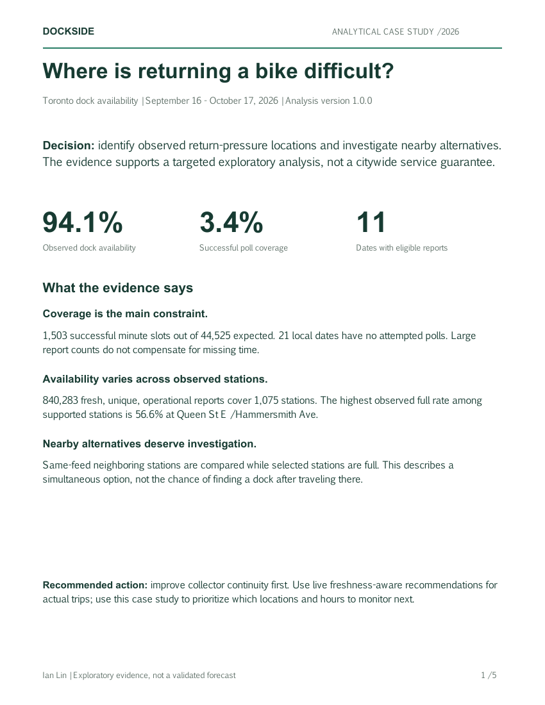

# Dockside analytical case study

**Question:** Where and when was returning a bicycle difficult in our collected
Toronto station reports, and what nearby option was observed at the same time?

This is an exploratory, reproducible analysis of self-collected **real GBFS data**.
It is not a trip-demand analysis, a forecast validation, or a live rider trial.
The existing application is unchanged by this analysis.

[](../../output/pdf/Dockside_Case_Study.pdf)

## Deliverables

- [Excel analysis](../../outputs/portfolio-2026-10-17/Dockside_Analysis.xlsx): native
  charts, formula-linked metrics, filterable station tables, station-ID selector,
  weekday/weekend control, quality reconciliation and refresh instructions.
- [Five-page case study](../../output/pdf/Dockside_Case_Study.pdf): question,
  findings, coverage, station comparisons, nearby comparison and limitations.
- [SQL](sql/): CTEs, window-function deduplication, conditional aggregation,
  missing-minute generation, point-in-time metadata joins and spatial comparison.
- [Frozen aggregate exports](data/) and [extraction manifest](data/manifest.json):
  reproduce results without access to the local collector database.

## Project structure

```text
analysis/portfolio/
  config.json               Frozen window and eligibility rules
  sql/00_prepare.sql        Shared observation and expected-minute CTEs
  sql/01...10*.sql           Quality, daily, station, time, sensitivity and nearby analysis
  export.py                 SELECT-only, repeatable-read extraction
  data/                     Public aggregate CSV/JSON and hashes; no rider requests
  build_workbook.mjs         Excel authoring and formula/control validation
  build_report.py           Vector PDF report generation
  verify_artifacts.py       Independent saved XLSX/PDF checks
  verification.json         Artifact checks and SHA-256 hashes
  findings.md               Measured conclusions and publication checks
outputs/portfolio-2026-10-17/Dockside_Analysis.xlsx
output/pdf/Dockside_Case_Study.pdf
tests/unit/test_portfolio.py
tests/integration/test_portfolio_sql.py
```

## Scope and metric contract

| Item | Definition |
| --- | --- |
| Frozen window | 2026-09-16 18:55 UTC inclusive to 2026-10-17 17:00 UTC exclusive |
| Local calendar | America/Toronto; first/last local dates are partial days |
| Source | Online `station_snapshots`, `provenance_kind=live`; no fixtures or trip reconstruction |
| Knowledge cutoff | Both retrieval and ingestion must be before the frozen end |
| Deduplication | Earliest canonical retrieval per station/source `last_reported` timestamp within the window |
| Corrections | Same-timestamp conflicts are counted; the first canonical report wins |
| Freshness | Age at retrieval in [-30, 300] seconds; 60/120-second sensitivity comparisons |
| Eligible report | Fresh, installed, accepting returns and known reported dock count |
| Availability | Eligible reports with at least one dock / eligible reports |
| Full share | Eligible reports with zero docks / eligible reports |
| Average docks | Sum of reported docks / eligible reports; not a continuous-time average |
| Poll coverage | Distinct minute slots with successful batches / all expected 60-second slots |
| Support rule | Station ranking requires >=100 eligible reports on >=5 dates |
| Nearby analysis | For the 10 highest supported full-rate stations, nearest fresh operational neighbor within 750 m in the same fetched feed while primary is full |

Reported usable docks are authoritative. We do not calculate capacity minus bikes
or subtract disabled docks again. Generic bicycle compatibility is assumed. No
gap interpolation is used. Missing observations are not zero availability.

The metadata version attached to each snapshot is used. Station export names and
locations are the last eligible observed values in the window, not a claim that
the station has never moved. Invalid local coordinates exclude spatial pairing,
but not otherwise valid nonspatial dock observations.

**Different from the browser dashboard:** this study deduplicates source report
timestamps; the dashboard summarizes collected polling observations. The rates
can therefore differ. Neither rate is elapsed-time service reliability or
recommendation success. Deduplication also introduces report-update weighting;
stations that update more often can contribute more observations.

## Reproduction

### Review without Docker

Download the XLSX/PDF and inspect the CSVs. Their numbers are a frozen snapshot,
not a connection to a continuously updating database. Excel filters apply to its
tables; headline totals intentionally represent the full study unless the nearby
station/hour controls explicitly change a view. The workbook has no macros,
external workbook links, embedded credentials, Power Query or database connection.

Run the aggregate verification using the project's locked development environment:

```sh
make bootstrap
uv run --locked --no-sync pytest tests/unit/test_portfolio.py
```

### Re-extract from a local collection database

```sh
python3 analysis/portfolio/export.py
```

Requires the existing project Compose database and Python 3.11+. It uses the
container's configured database connection without printing credentials. SQL runs
inside `REPEATABLE READ READ ONLY`, with a five-minute statement timeout, then
rolls back. The export contains only public station aggregates, counts and source
fingerprints; raw responses, rider destinations and secrets remain local.

To choose another period, change `config.json` deliberately, regenerate all assets
and findings, and retain this dated release in Git history. Retention/archiving can
make a later online-only extract incomplete. This exporter does not silently merge
archives or dashboard summaries. The published aggregate snapshot remains the
reproduction source for this edition.

### Rebuild the presentation artifacts

```sh
node analysis/portfolio/build_workbook.mjs
python analysis/portfolio/build_report.py
```

The workbook builder uses the `@oai/artifact-tool` 2.8.94 authoring runtime; this is a
build-time dependency, not needed to open the XLSX or run the application. The PDF
builder requires ReportLab (see `requirements-report.txt`). The delivered Excel
file was recalculated, formula-scanned, control-tested and rendered. PivotTable
export is unreliable in the authoring runtime, so the workbook intentionally uses
formula-backed views and native table filters instead of claiming PivotTables or
slicers. Native Excel application checks, if performed, are recorded in findings.

This runtime must be available to Node's module resolver; it is not bundled in
the repository. PDF dependencies are pinned in `requirements-report.txt`. The
application and published CSVs do not require either artifact-building runtime.
Run `python analysis/portfolio/verify_artifacts.py` with pypdf installed to check
saved formulas, native chart/table counts, controls, PDF pages and file hashes.

To independently inspect PDF layout with Poppler:

```sh
pdftoppm -scale-to 1200 -png output/pdf/Dockside_Case_Study.pdf /tmp/dockside-case
```

## Limitations

- Collection gaps are substantial and nonrandom. Coverage on a few dates does
  not imply a representative month, weekday pattern or seasonal result.
- Reports within a station and across neighboring stations are correlated. No
  binomial confidence interval treats millions of rows as independent evidence.
- The report-weighted rate overrepresents well-observed stations and periods.
  Freshness sensitivity is useful but does not correct that selection bias.
- Installed/returning status and dock counts are publisher reports, not an
  independent physical dock inspection. Unknown values are excluded and counted.
- The nearby comparison has no travel-time model. It is neither a sequential
  backup success rate nor a guarantee that a dock will remain available.
- Inventory does not identify trips, users, motives or rebalancing operations.
- No validated model, causal claim, 82% success or +14 pp uplift is established.

## Sources and license

Self-collected [Bike Share Toronto GBFS v3](https://toronto.publicbikesystem.net/customer/gbfs/v3.0/gbfs.json).
Definitions checked against the [GBFS v3 reference](https://gbfs.org/documentation/reference/)
on 2026-10-17. Contains information licensed under the
[Open Government Licence - Toronto](https://www.toronto.ca/city-government/data-research-maps/open-data/open-data-licence/)
(accessed 2026-10-17). Software is MIT; that does not relicense source data.
This independent project has no official endorsement. The existing
[source index](../../docs/sources.md) records the catalogue/directory licensing discrepancy.
